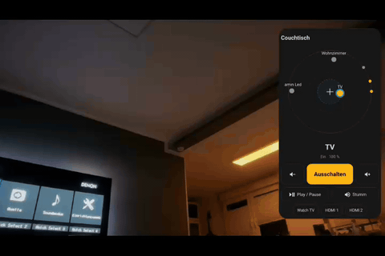
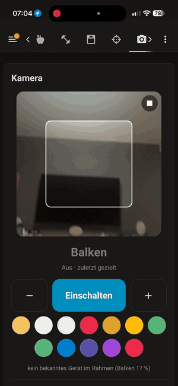

# Point Remote Card

[](https://hacs.xyz/docs/faq/custom_repositories)
[](https://github.com/onkeloki/point-remote-card/actions/workflows/validate.yml)

**Point your phone at a lamp, blind, TV or amplifier – and control it.**

<p align="center">
  
</p>

A Home Assistant dashboard card that turns your phone into a pointing remote. No extra hardware, no beacons:
the card reads the phone's compass and tilt sensors, so it knows where the top edge of the phone is pointing.
You teach each device's direction once from a place (couch, kitchen, …), and from then on you just aim and tap.

## Features

- 🎯 **Aim & control** – the device you point at is shown big, with controls that fit it:

  | Device | Controls |
  |---|---|
  | Light | on/off, dim −/+, warm/neutral/cold white, colour swatches (only what the lamp supports) |
  | Cover / blind | up · stop · down, position presets |
  | Media player (TV, amplifier) | power, volume −/+, play/pause, mute, source buttons |
  | Fan | on/off, speed −/+ |
  | Climate | target temperature −/+ |
  | Lock | lock / unlock |
  | Switch, input boolean | on/off |
  | Scene, script, button | activate / run / press |
- 📷 **Camera mode** – no compass, no fixed place: aim the camera at a device and it is recognised in the picture (see below)
- 📡 **Radar view** – all taught devices around your current aim (amber = on/open, grey = off)
- 🛋️ **One card per place** – add several cards (“Couch”, “Kitchen”, …), each with its own taught directions
- 📍 **Location-aware** – combine with Home Assistant's card *visibility* conditions to show the right card where you are (see below)
- 📳 **Haptic feedback** in the companion app; the target stays selected until you aim at another device, so you can lower the phone to tap
- 🌍 **English, German, Dutch, French, Spanish, Italian** – follows your Home Assistant language (translations welcome!)
- ☁️ Directions are stored in your Home Assistant user profile and work on every device you log in with

## Installation

### HACS (custom repository)

1. HACS → ⋮ → **Custom repositories**
2. Repository: `https://github.com/onkeloki/point-remote-card`, type **Dashboard**
3. Install **Point Remote Card** and reload the browser / app

### Manual

1. Copy `point-remote-card.js` to `/config/www/point-remote-card.js`
2. Settings → Dashboards → ⋮ → **Resources** → add `/local/point-remote-card.js` as *JavaScript module*

## Configuration

The card has a visual editor. In YAML:

```yaml
type: custom:point-remote-card
name: Couch            # name of the place, shown as title
id: couch              # optional storage id – set it if you want to rename the card later without re-teaching
entities:              # optional – without it, every supported device can be taught
  - light.living_room
  - cover.blind_left
  - media_player.tv
```

Per-device options (YAML only):

```yaml
entities:
  - entity: light.led_strip
    name: LED strip
    colors: ["#ff0000", "#00ff00", [0, 80, 255]]   # own colour swatches
  - entity: cover.blind_left
    positions: [0, 30, 60, 100]                   # own position presets
  - entity: media_player.amplifier
    sources: [TV, Spotify, Radio]                 # only these source buttons (false = none)
```

### Several places, automatically

Each card is one place. Use the built-in visibility conditions to show the right one, e.g. with a room-presence sensor
([Bermuda](https://github.com/agittins/bermuda), ESPresense, …):

```yaml
type: sections
max_columns: 1
sections:
  - type: grid
    cards:
      - type: custom:point-remote-card
        name: Couch
        visibility:
          - condition: state
            entity: sensor.my_phone_area
            state_not: Kitchen
      - type: custom:point-remote-card
        name: Kitchen
        visibility:
          - condition: state
            entity: sensor.my_phone_area
            state: Kitchen
```

## Usage

1. Open the card on your phone and tap **Enable sensors** (iOS asks for motion & orientation access once).
2. Open **Teach devices**, pick a device, point the **top edge** of the phone at it and tap **Point now & save**. Hold still for a second.
3. Repeat for each device.
4. Now just point – the device is recognised and its controls appear.

## Good to know

- Directions are relative to **where you are**. Teach them from the place you'll use; use one card per place.
- Indoor compasses are bent by speakers, radiators and steel, but since you teach and use from the same place, that error is mostly the same both times and cancels out.
- Devices closer together than ~10–15° (seen from your place) are hard to tell apart; the card then says “close call”.
- If the hint says the compass is inaccurate, move the phone in a figure eight.
- **iOS needs https** for the sensor permission (e.g. Nabu Casa or your own TLS). Plain `http://homeassistant.local:8123` will not get sensor access.
- Taught directions are stored per Home Assistant user.
- Built and tuned for iPhone. Android uses the absolute orientation event and should work, but is untested so far – feedback welcome.

## Camera mode

Compass directions only work from the place you taught them. If you walk around a lot, use the camera mode instead:
the card shows the camera picture with a frame, and the device inside the frame is recognised.

<p align="center">
  
</p>

```yaml
type: custom:point-remote-card
mode: camera
name: Camera remote
entities:              # optional – limit recognition to these devices
  - light.floor_lamp
  - media_player.tv
camera_threshold: 0.7  # optional – how similar the picture must be (0…1), default 0.7
```

1. Tap **Start camera** and allow access.
2. Open **Teach devices**, pick a device, aim so the device fills the frame and tap **Save view**. Hold still for a second.
3. Save **2–3 views per device** from different spots and distances (and maybe with the light on and off). The more views, the better it works wherever you stand.
4. Now just aim – the frame turns amber and the controls appear.

Good to know:

- Recognition runs **on the phone**. No picture leaves the device; only a compact fingerprint of each taught view (≈1.4 kB) is stored in your Home Assistant user profile. Camera views are shared by all camera cards of a user.
- On first start the card loads the [MediaPipe](https://ai.google.dev/edge/mediapipe) image embedder (≈4 MB library + model from jsDelivr and Google, cached afterwards). For an offline setup host the files yourself and set `camera_lib` (folder of `@mediapipe/tasks-vision`) and `camera_model` (`.tflite` URL).
- The card compares the whole frame, not just the device. Two devices that look alike *and* stand in a similar spot can be confused – then save more views or a closer one. The hint below the controls shows the current match score, which helps to tune `camera_threshold`.
- The camera only runs while the card is visible and stops when the app goes to the background. Tap ■ to stop it.
- Needs **https** like the compass. Tested in Chrome; in the companion apps the app must be allowed to use the camera – feedback welcome.

## Upgrading from zeig-licht-card 1.x

The card was renamed. `custom:zeig-licht-card` keeps working, and a card without `name`/`id` (or with `id: default`) takes over the directions taught with 1.x.

## How it works

The heading of the phone's top edge is `360° − alpha` and its tilt is `beta` of the
[DeviceOrientation](https://developer.mozilla.org/docs/Web/API/DeviceOrientationEvent) event. On iOS, `alpha` is not north-referenced,
so the card continuously estimates an offset from `webkitCompassHeading`. The device whose stored direction has the smallest
angle to the current aim (max. 18°) is selected.

## License

MIT
